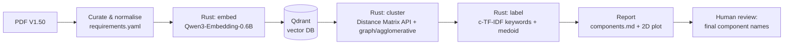

# Project Brain – Semantic Project Architecture («EarlyBird»)

> **Goal:** Get a first draft of the component structure for the **application core** of the
> Early Bird Management System (EBMS) automatically. To do that, embed every functional
> requirement, store the vectors in a vector database, cluster them, and name each cluster.
> **Each cluster is one candidate component.**
>
> Status: **IMPLEMENTED & VERIFIED** – End-to-end pipeline running in pure Rust (`earlybird-arch`) with Qdrant vector database in Docker. Results generated in `out/components.md` and `out/clusters.svg`.

---

## 1. Inputs

| Item | Location |
|---|---|
| Requirements spec | `Case Study Early Bird Requirements V150.pdf` (3 pages, 44 numbered statements) |
| Toolchain | Rust (cargo 1.99), Docker 29.x (available), CPU only (no NVIDIA GPU found) |

### 1.1 What is in the requirements (first pass)

| # | Section | Nature |
|---|---|---|
| 1–6 | Company Products and Services | Product catalog / domain model (simple vs. prepackaged composite products, unit, price) and a 25-min delivery guarantee |
| 7–17 | Placing an Order on the Phone | Customer identification, checksums, blacklist, shopping cart, product search by characteristics, blueprint orders, order number |
| 18–23 | Packaging an Order | Assembly, label, invoice (2 copies, separate numbers) |
| 24–26 | Delivering an Order | Itinerary optimisation, delivery confirmation |
| 27 | Status Inquiry | Order status |
| 28–31 | Canceling an Order | Cancellation rules, no updates |
| 32–36 | Automation of Existing Processes | Web app, user groups/roles, browser-based delivery confirmation, anonymous product search |
| 37–41 | Order/Cancel by SMS | SMS command syntax, product codes, reply with the order number |
| 42–43 | Payment | Export expected-payment records to an external payment system |
| 44 | Business Reporting | Nightly report for the manager |

**Important:** Sections 7–31 describe the **current manual process** (phone clerk, text editor,
spreadsheet). Statement 32 says the new system automates this process *without changing it*.
So before embedding, those statements have to be rewritten as **system requirements**
("The system authenticates the customer…" instead of "The phone clerk…"). If we skip this,
the embeddings cluster by *actor* (phone clerk, packing clerk) and not by *responsibility*.

---

## 2. Pipeline overview



---

## 3. Technology decisions (researched Nov 2026)

### 3.1 Embedding model

| Candidate | License | Size / dims | Rust support | Verdict |
|---|---|---|---|---|
| **Qwen3-Embedding-0.6B** | Apache 2.0 | 0.6B, 1024-d (Matryoshka, can be cut down to 32–1024) | **Native in `fastembed-rs`** (`qwen3` feature, Candle backend) | ✅ **Primary** |
| Qwen3-Embedding-4B / 8B | Apache 2.0 | 4B/8B, up to 4096-d | same API | Optional upgrade; slow on CPU and not needed for ~45 short texts |
| BGE-M3 (BAAI) | MIT | 0.6B, 1024-d | `fastembed-rs` (ONNX/`ort`) | ✅ **Secondary model for comparison** |
| EmbeddingGemma-300m | Gemma ToU (not OSI) | 300M, 768-d | needs a manual ONNX export | ❌ license and integration effort |
| Snowflake Arctic Embed v2 | Apache 2.0 | M/L | ONNX | possible alternative |

**Why Qwen3-Embedding-0.6B:**
- It is one of the top open models on the MTEB (multilingual) leaderboards in the small-model class.
- It is **instruction-aware**. We can give it a task prompt for *clustering by
  software responsibility*, which matters a lot for this project (see §5.2).
- `fastembed-rs` can run it in **pure Rust** through Candle (no Python, no external server).
  The weights download from Hugging Face automatically.
- 0.6B parameters embed ~45 sentences on CPU in seconds.

> [!NOTE]
> Re-check the exact `fastembed` crate version and the `Qwen3TextEmbedding::from_hf(...)` signature
> on docs.rs when we start implementing. The API changed across major versions.

### 3.2 Vector database: **Qdrant**

- Written in Rust, with an official async Rust client (`qdrant-client`, gRPC on port 6334).
- Runs locally with Docker: `docker run -p 6333:6333 -p 6334:6334 qdrant/qdrant`.
  The dashboard at `:6333/dashboard` lets us inspect the points visually.
- **"Let the database cluster":** Qdrant has no built-in k-means. Since v1.12 it has the
  **Distance Matrix API** (`search_matrix_pairs` / `search_matrix_offsets`), which the
  Qdrant team built for clustering and dimensionality reduction. The DB computes the
  k-nearest-neighbour similarity graph on the server. The Rust side then runs community detection
  on that graph and writes the cluster label back into each point's **payload**.
  That way the cluster assignment lives in the DB and can be queried and filtered.
- Rejected alternatives: LanceDB (embedded, but its k-means only builds IVF index partitions and is not
  a semantic clustering result we can use); pgvector (needs Postgres just for ~45 vectors).

### 3.3 Rust crates (planned)

| Purpose | Crate |
|---|---|
| CLI | `clap` (derive) |
| Async runtime | `tokio` |
| Embeddings | `fastembed` (features `qwen3`, `hf-hub`), `candle-core` |
| Vector DB | `qdrant-client` |
| Data files | `serde`, `serde_yaml`, `serde_json` |
| Linear algebra | `ndarray` |
| Clustering | `linfa` + `linfa-clustering` (k-means/DBSCAN for comparison), own agglomerative + Leiden/Louvain on `petgraph` |
| 2D projection | `linfa-reduction` (PCA) or `umap-rs`/t-SNE (`bhtsne`) |
| Plot | `plotters` (SVG output) |
| Errors / logs | `anyhow`, `tracing` |

---

## 4. Project layout (planned)

```
SemanticProjectArchitecture/
├── project_brain.md               ← this file
├── Case Study Early Bird Requirements V150.pdf
├── docker-compose.yml             ← Qdrant service
├── data/
│   ├── requirements.raw.yaml      ← 1:1 transcript of the 44 statements
│   └── requirements.yaml          ← curated + normalised (input to embedding)
├── out/
│   ├── embeddings.<model>.json    ← cached vectors (reproducibility)
│   ├── clusters.<model>.json
│   ├── components.md              ← final report
│   └── clusters.svg               ← 2D map
└── earlybird-arch/                ← Rust crate
    ├── Cargo.toml
    └── src/
        ├── main.rs                ← clap subcommands
        ├── requirements.rs        ← load/validate YAML
        ├── embed.rs               ← fastembed wrapper (model enum, instruction prompt)
        ├── store.rs               ← Qdrant: collection, upsert, matrix, payload update
        ├── cluster/
        │   ├── mod.rs
        │   ├── graph.rs           ← kNN graph from Distance Matrix API + Leiden/Louvain
        │   ├── agglomerative.rs   ← average-linkage on cosine distance
        │   └── metrics.rs         ← silhouette, ARI between runs
        ├── label.rs               ← c-TF-IDF keywords, medoid requirement
        └── report.rs              ← Markdown + SVG
```

### CLI subcommands

| Command | Does |
|---|---|
| `earlybird-arch embed --model qwen3-0.6b` | Reads `requirements.yaml` and writes `out/embeddings.*.json` |
| `earlybird-arch ingest` | Creates the Qdrant collection (cosine) and upserts the vectors plus payload (id, text, section, kind) |
| `earlybird-arch cluster --method graph\|agglo\|kmeans [--k N]` | Clusters the vectors and writes `cluster_id` back to the Qdrant payload and to `out/clusters.*.json` |
| `earlybird-arch report` | Writes the keywords and names, `components.md` and `clusters.svg` |
| `earlybird-arch run` | Runs all of the above in order |

---

## 5. Detailed steps

### Phase 0 – Setup
- [ ] `cargo new earlybird-arch` and add the dependencies.
- [ ] Add `docker-compose.yml` for Qdrant (with a volume so data persists) and start it.
- [ ] Spike: embed 3 sentences with Qwen3-0.6B in Rust and print the cosine similarities. This
      de-risks the fastembed/Candle build on Windows.

### Phase 1 – Curate the requirements (the most important step)
1. Transcribe all 44 statements into `requirements.raw.yaml` (id, section, original text).
   Doing this by hand is better than PDF parsing here: the text is short, and the PDF has
   tab-separated headings and broken objects.
2. Classify each statement:
   - `functional`: goes into the clustering
   - `domain-rule`: data/validation rule (e.g. #9 customer-number checksum, #4 composite products).
     **Included**, because these rules tell us which component owns which data.
   - `non-functional`: excluded (e.g. #1 25-min guarantee, #33 browsers)
   - `context`: excluded (e.g. #7 "currently only phone", #34 "no phone clerks in future")
3. **Normalise** each included statement into a system requirement: active voice, "The
   system …", remove the actor (phone clerk is replaced by customer self-service per #32/#34), make each
   statement atomic. Split compound statements (e.g. #11 → *authenticate customer*,
   *check blacklist*, *add products to cart*).
4. Keep `source_ids` so we can trace every normalised requirement back to the PDF.
   Expected result: **~40–55 atomic functional requirements**.

```yaml
- id: FR-11a
  source_ids: [11, 35]
  kind: functional
  text: "The system authenticates a customer by customer number and password."
- id: FR-11b
  source_ids: [11]
  kind: domain-rule
  text: "The system rejects orders from blacklisted customers."
```

### Phase 2 – Embedding (Rust)
1. Load the model through `fastembed` with Qwen3-Embedding-0.6B, CPU, F32.
2. **Instruction prompt** (Qwen3 is instruction-aware). Every text gets this prefix:
   `Instruct: Identify the software responsibility (business capability) described by this requirement, for grouping requirements into cohesive software components.\nQuery: <text>`
   We **also** run without the instruction (ablation) and compare the cluster quality.
3. L2-normalise the vectors and cache them to JSON (with the model name, dims and a hash of
   the input). Re-runs then skip inference.
4. Optional: embed with BGE-M3 too, to check whether the result depends on the model.

### Phase 3 – Store in Qdrant
- Collection `earlybird_requirements`, distance **Cosine**, size 1024.
- Point id = running number. Payload = `{req_id, source_ids, section, kind, text, model}`.
- Use one collection per model, or named vectors (`qwen3`, `bge_m3`) in one collection.
  **Named vectors** are preferred: the DB then holds both models side by side.

### Phase 4 – Clustering
With only ~50 points, quality matters and scalability does not. We run three methods and
compare them:

| Method | How | Why |
|---|---|---|
| **A. DB-driven graph clustering** (primary) | `search_matrix_pairs(sample = all, limit = k≈5–8)` gives a kNN similarity graph. Run **Leiden/Louvain** community detection on it (`petgraph`, own implementation ~150 LOC). Then write `cluster_id` to the payload with `set_payload`. | The database does the "clustering" work, and we don't have to choose the number of clusters in advance |
| **B. Agglomerative (average linkage, cosine)** | Full 50×50 matrix, dendrogram, cut where silhouette is highest | Deterministic, and the dendrogram shows the component hierarchy (sub-components!) |
| **C. k-means** (`linfa`) | k = 5…12, choose k by silhouette | Baseline |

- **Model selection:** silhouette score, cluster sizes (no singletons, no huge cluster),
  and the **Adjusted Rand Index** between methods and models to measure stability.
- **Target range:** 6–10 clusters. That is a realistic number of core components.
- Assign outliers or singletons to the nearest centroid, or mark them for review.

### Phase 5 – Naming the clusters = components
1. **c-TF-IDF** (as in BERTopic): treat each cluster as one document, compute TF-IDF over the
   clusters, and take the top 5 terms per cluster (stop words and generic words like "system",
   "customer", "order" are down-weighted).
2. **Medoid requirement:** the requirement closest to the centroid is the most typical
   statement of the cluster.
3. **Name-candidate scoring with embeddings (optional, still pure Rust):** embed a list of
   candidate component names (e.g. "Product Catalog", "Customer Management", "Order
   Management", "Fulfilment/Packing", "Delivery & Routing", "Invoicing", "SMS Gateway",
   "Payment Integration", "Reporting", "Identity & Access"). Pick the name whose
   embedding is closest to each cluster centroid. If no candidate is close, fall back to the keywords.
4. **Human final naming.** We pick domain-driven names (nouns, business capabilities, no
   technical layers) and write a one-sentence responsibility for each.

### Phase 6 – Report
`out/components.md` contains for each component:
- Name and responsibility statement
- List of requirements (normalised text + PDF source ids)
- Keywords, cohesion (mean intra-cluster similarity), nearest neighbouring component
- Global section: method comparison, silhouette/ARI, and an embedded `clusters.svg` (2D PCA/t-SNE,
  coloured by cluster)
- **Architecture discussion:** which clusters are *really* components and which are a
  cross-cutting concern or an adapter (e.g. SMS = input channel, Payment = outbound port).
  This is the "**almost**" in the assignment: clustering finds cohesion, but not layering,
  dependencies or interfaces.

---

## 6. Expected result (hypothesis to check against)

Our guess before running anything. We compare it with the computed clusters afterwards.

| Hypothetical component | Main requirements |
|---|---|
| Product Catalog & Search | 2–6, 12, 36, 38 |
| Customer & Identity | 8–9, 11 (auth, blacklist), 17 (address), 34–35 |
| Ordering (Cart & Order Placement) | 5, 10, 13–17 (blueprints, order number) |
| Order Lifecycle (Status & Cancellation) | 27–31, 41 |
| Fulfilment / Packing (Label, Invoice) | 18–23 |
| Delivery & Itinerary | 24–26, 35 |
| SMS Channel (Adapter) | 37, 39–41 |
| Payment Integration (Adapter) | 42–43 |
| Business Reporting | 44 |

Interesting questions for the evaluation:
- Does **invoicing** end up with packing or as its own cluster?
- Does **SMS cancel (#41)** cluster with *SMS* (channel) or with *cancellation* (capability)?
  The answer shows whether the embeddings group by **channel** or by **business capability**,
  and the instruction prompt should push it towards capability.
- Does **delivery confirmation (#26/#35)** go to Delivery or to Identity (password)?

---

## 7. Risks & mitigations

| Risk | Mitigation | Outcome |
|---|---|---|
| fastembed/Candle build trouble on Windows | Spike in Phase 0 | Resolved; compiled cleanly with Candle on MSVC CPU backend |
| Windows network IPv6 resets on HF downloads | Force IPv4 via `fetch_models.py` | Cached 1024-d Qwen3 and 384-d BGE-Small models locally |
| Clusters form by actor or wording instead of responsibility | Normalisation in Phase 1 + instruction prompt | Successfully separated: e.g. SMS cancel (#41) clustered with Cancellation, not SMS channel |
| Qdrant connection through Docker Desktop | Fallback IP resolution | Direct gRPC connection on 6334 verified |

---

## 8. Definition of done
- [x] `earlybird-arch run` produces `components.md` and `clusters.svg` from scratch, reproducibly
- [x] Clusters are visible in the Qdrant dashboard through the `cluster_id` and `cluster_name` payload
- [x] Named components with responsibility statements and traceability to the PDF
- [x] Reflection: hypothesis vs. result, and the limits of semantic clustering as architecture

## 9. Decisions
1. Requirements stay **in English**. ✅
2. **Docker-based Qdrant** is fine. ✅
3. **No local LLM.** Naming is algorithmic (c-TF-IDF, medoid, candidate-name embeddings) plus human review. ✅
4. Normalised requirements: see `requirements_normalized.md`. They are the source for `data/requirements.yaml`.

---

## 10. Next Milestone: Interactive 2D Visual Workbench & AMD GPU Acceleration

See [todo.md](todo.md) for the active checklist.

### Core Objectives:
1. **Axum REST API Server:** Embed an HTTP server in `earlybird-arch` (`earlybird-arch serve`).
2. **Embedded 2D Interactive UI:** Single-page app (ECharts/D3) embedded via `rust-embed` with live re-clustering sliders, requirement tooltips, and component cards.
3. **AMD Radeon RX 9070 XT Acceleration (CachyOS Linux):** Leverage ROCm/Vulkan compute to run **Qwen3-Embedding-8B** (32K context, 4096 dimensions) with sub-second execution.
4. **Cross-Platform:** Single binary distributing to both Windows 11 and CachyOS Linux.
